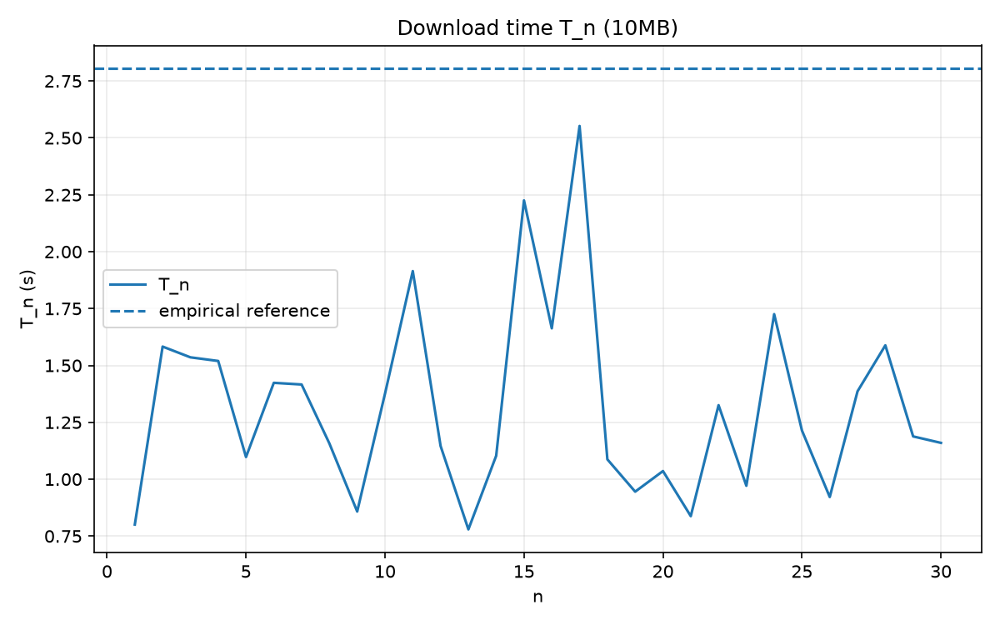
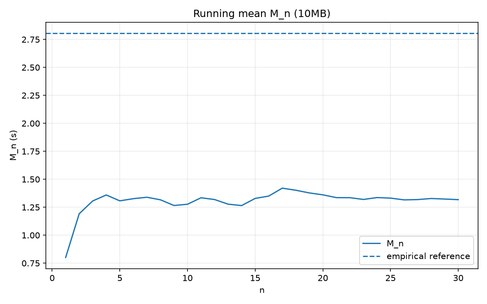
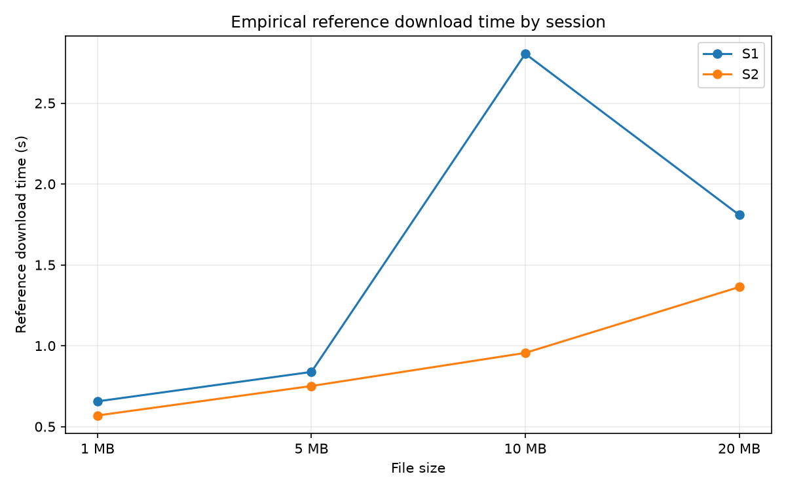

# Real Analysis: Download-Time Sequences

## Overview

This group research project applies concepts from real analysis to measured file-download times. Repeated downloads are used to construct finite sequences, examine their empirical behavior, and investigate stability relative to a reference mean.

The experiment compares four file sizes across two collection sessions, S1 and S2. Python scripts collect and analyze the measurements, validate the recorded observations, and generate tables and figures.

## Objectives

- Construct sequences from repeated download-time measurements.
- Calculate running means and deviations from a reference mean.
- Examine empirical stability using multiple relative-error tolerances.
- Compare download-time behavior and variability across collection sessions.
- Discuss the limitations of drawing conclusions about infinite sequences from finite experimental observations.

## Experimental Setup

Four file sizes are investigated:

| File size | Size in bytes |
| --------- | ------------: |
| 1 MB      |     1,000,000 |
| 5 MB      |     5,000,000 |
| 10 MB     |    10,000,000 |
| 20 MB     |    20,000,000 |

Each session aims to collect 40 valid observations per file size:

- **Analysis block:** observations \(n=1,\ldots,30\).
- **Reference block:** observations \(n=31,\ldots,40\).

The reference block provides a finite-sample benchmark for the empirical stability analysis.

## Mathematical Framework

Let $T_n$ denote the measured download time, in seconds, for observation $n$.

The running mean is

$$
M_n = \frac{1}{n}\sum_{k=1}^{n} T_k.
$$

Let $L_{\mathrm{ref}}$ denote the mean download time of the reference block. The absolute deviation from this reference is

$$
E_n = \left|T_n - L_{\mathrm{ref}}\right|,
$$

and the relative error is

$$
e_n = \frac{\left|T_n - L_{\mathrm{ref}}\right|}{L_{\mathrm{ref}}}.
$$

For a selected tolerance $\varepsilon$, the empirical stability index is the first $K$ such that

$$
E_n \leq \varepsilon L_{\mathrm{ref}}
$$

for every observed index $n = K,\ldots,30$. If no such index exists, no stability index is reported for that tolerance.

Download throughput is calculated as

$$
R_n = \frac{8S}{10^6 T_n}\ \text{Mbps},
$$

where $S$ is the file size in bytes and $T_n$ is the measured download time in seconds.

## Selected Figures

### 1. Download-Time Sequence — Session S1, 10 MB



This figure shows the observed download times across the collection sequence.

### 2. Running Mean — Session S1, 10 MB



The running mean illustrates how the average of the observations changes as additional measurements are included.

### 3. Comparison Between Sessions



This figure summarizes the comparison between the two collection sessions.

Additional figures and result tables for both sessions and all four file sizes are available in the `results/` directory.

## Repository Contents

- `analysis.py` — Validates the recorded data, calculates descriptive statistics and empirical stability measures, compares sessions, and generates tables and figures.
- `data_collection.py` — Collects download measurements and records attempts and successful observations.
- `requirements.txt` — Lists the Python dependencies.
- `data/` — Contains collected observations, raw attempt records, and session summaries.
- `results/` — Contains analysis figures, result tables, and the validation report.
- `test_data/` — Contains files used for testing the collection workflow.
- `TEST_collection_summary.csv` and `TEST_validation_report.txt` — Record outputs from the collection testing workflow.
- `urls.json` — Stores the configured download URLs used by the collection script.

## Running the Analysis

Create and activate a Python virtual environment in PowerShell:

```powershell
python -m venv .venv
.\.venv\Scripts\Activate.ps1
pip install -r requirements.txt
```

Run the analysis script:

```powershell
python analysis.py
```

The data collection script is:

```powershell
python data_collection.py
```

Review the script configuration before starting a new collection, since the collection process may contact remote download endpoints and write new data.

## Limitations

- The dataset is finite and cannot establish convergence of an infinite sequence.
- Download times may be affected by network conditions, server behavior, and other uncontrolled factors.
- The reference mean depends on the measurements in the reference block and may be sensitive to unusually long or short observations.
- Empirical stability relative to a finite-sample reference is not equivalent to proving mathematical convergence.
- Comparisons across two sessions provide limited experimental evidence and should not be generalized to all network conditions.

## Academic Context

Prepared as a group research project for **MAT401 Real Analysis**, this project connects mathematical concepts involving sequences, means, and convergence with a computational experiment based on measured download data.
